  
  
  
  

**Backend developer focused on reliability**: production systems that can't go down, such as **ERP ↔ e-commerce integration gateways**, **multi-tenant SaaS**, and **AI-powered automation**. At **BS Automação** I work as a **solo developer, from architecture to production**, mostly with **.NET / C#**, **Node.js**, and **TypeScript**, plus messaging and AI agents (Claude, MCP).

- 🧑‍💻 5 years coding · Junior Developer since May 2026, promoted from technical support
- 🎓 B.Sc. in Computer Science, Cruzeiro do Sul University (2025–2028)
- 🌎 Advanced English · Portuguese (native)
- 🛠️ Solo dev: architecture → production
- 📍 Brazil · remote or on-site · open to relocation

| | |
|---|---|
| **Languages & frameworks** |      |
| **Data & messaging** |      |
| **DevOps & architecture** |     |
| **AI & agents** |     |
| **Frontend when needed** |    |

> [!NOTE]
> **Why does this profile look empty?** Almost everything I build runs in production for clients, so the repositories are **private**. Below is what each system does, the results it delivered, and how it was engineered. Redacted screenshots and full write-ups are at **[jingg.dev](https://jingg.dev)**.

### ABC Gateway · ERP ↔ Lexos integration for Loja ABC
**~5 orders/min · ~3 s per sync batch · 99.6% of batches error-free**
- Incremental sync driven by the ERP's product revision number: it only runs when something changed.
- RabbitMQ consumer with manual ack and prefetch 1: a message is only acknowledged after it's processed.
- The API client honors `Retry-After` on rate limits, and the queue connection recovers on its own.

**Result:** no more re-registering products by hand, physical stock matches online sales, and changed SKUs are detected automatically. · `.NET` `RabbitMQ` `PostgreSQL` `Docker`

### Fechadin · Automated monthly tax closing for retail stores
**88% fewer closing errors (17 → 2 stores/month) · ~40 h/month of manual work saved · 37 agents live**
- Self-healing agent (Windows Service): a machine that was off on the 1st closes when it boots; if only the email failed, only the email is resent.
- Sequential invoice numbering is the source of truth: it detects gaps, retransmitted invoices, and unauthorized ones.
- Agents stream state to a real-time dashboard over SignalR; every alert reaches the log, the dashboard, the PDF, and the email.

**Result:** far fewer missing invoices and wrong reports, which used to mean fines, and accounting firms started referring new clients. · `.NET` `SignalR` `PostgreSQL` `React`

### BS Reuniões · AI meeting summaries with no bot in the call · [**open ↗**](https://reunioes.bsautomacao.com.br)
- System and microphone audio on separate channels tells who spoke without diarization.
- Two-layer AI spend lock: at the route and right before every paid call.
- CI/CD with an SSH key restricted to a single command plus a health check: no response in 30 s and the previous build is restored automatically.

**Result:** every meeting ends with a summary, critical points, and tasks created automatically. The internal tool became a product. · `Node.js` `Claude` `Whisper` `Swift`

### Reportadin · Multi-tenant reporting over ERP data · [**open ↗**](https://reportadin.bsautomacao.com.br)
- Tenant isolation enforced in the ORM (global query filter), never in hand-written `WHERE` clauses: nothing leaks by omission.
- Background generation queue with real-time progress and Chromium-rendered PDFs.
- 136 automated tests (75 backend, 61 frontend), per-account lockout, and login rate limiting.

`.NET` `EF Core` `PostgreSQL` `React`

### BSChat MCP · Lets AIs run the customer-service platform
- MCP server with 76 tools: Claude, Cursor, n8n, or any MCP agent handles messages, tickets, and CRM for each client in production.
- Strict TypeScript, Zod validation on every input, and tests against a real PostgreSQL.
- SSRF mitigation with DNS checks, security headers, and per-client licenses and quotas.

`TypeScript` `Fastify` `MCP` `PostgreSQL`

<b>More projects</b>

| Project | What it does | Access |
|---|---|:-:|
| **Lookchina Gateway** | ERP ↔ e-commerce integration for Grupo Lookchina, with queued orders and real-time catalog sync | 🔒 |
| **Emitle** | SaaS for issuing Brazilian e-invoices (NF-e / NFC-e), multi-company, with an accountant dashboard | 🔒 |
| **Assistente de Gestão** | Store owners query and operate the ERP by voice, with purchase-cost alerts | 🔒 |
| **Organizei** | Tasks, team, and calendar, with an AI agent on Telegram that works as a secretary | [**open ↗**](https://organizei.bsautomacao.com.br) |

Generic rewrites of the flows behind my production systems: no client code, same engineering, with tests you can run.

| Repository | |
|---|---|
| [**reliable-sync-gateway**](https://github.com/4RTHURsantos/reliable-sync-gateway) | ERP → e-commerce sync in .NET + RabbitMQ: incremental sync, at-least-once delivery with idempotent apply, retry and dead-letter queues, `Retry-After`. 87 tests, incl. Testcontainers |
| [**self-healing-agents**](https://github.com/4RTHURsantos/self-healing-agents) | Monthly-closing agents that catch up after power loss and resume only the failed step, with sequence gap detection and a live SignalR dashboard. 31 tests |
| [**mcp-server-production-template**](https://github.com/4RTHURsantos/mcp-server-production-template) | Multi-tenant MCP server in TypeScript: hashed tenant keys, per-plan quotas, Zod-validated tools, SSRF guard. 94 tests against real PostgreSQL |
| [**cs16-web-windows**](https://github.com/4RTHURsantos/cs16-web-windows) | Counter-Strike 1.6 in the browser for LAN parties: one Docker container on Windows, everyone joins through a link |
| [**ncm_certin**](https://github.com/4RTHURsantos/ncm_certin) | Validates product NCM codes in a spreadsheet against the official SISCOMEX table |

Open to new projects, full-time roles, and technical collaborations.

**[jingg.dev](https://jingg.dev)** · **[LinkedIn](https://www.linkedin.com/in/jingg-developer/)** · **[arthur.a.silvabs@gmail.com](mailto:arthur.a.silvabs@gmail.com)**

